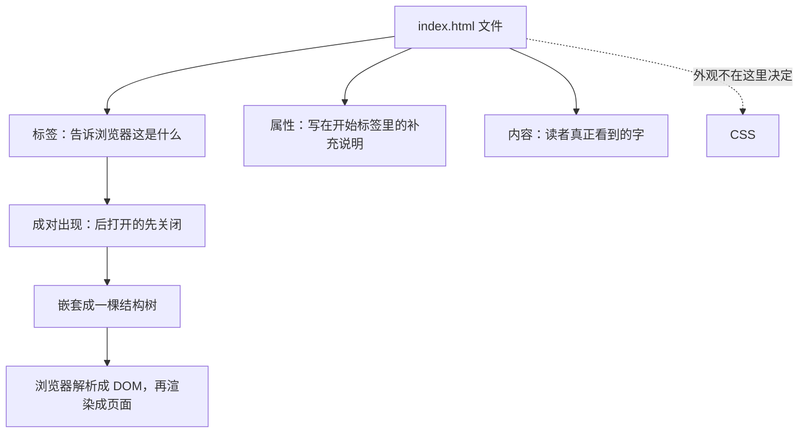

# HTML 是什么？零基础看懂网页结构

## 1. 基本概述

你打开一个网页，看到大标题、几段文字、一张图、一个按钮。它们排得整整齐齐，好像页面「知道」哪个是标题、哪个是正文。

可是浏览器看到的只是几个文本文件。它凭什么知道这些字里，哪一句该放大、哪一段该换行？凭什么知道这张图属于上面那篇文章，而不是下面那一块？

答案在一个 `.html` 文件里。这份文件用一堆尖括号，把「页面上有什么、谁在谁里面」写得清清楚楚。浏览器照着它，一个元素一个元素地摆出来。

所以先给一句不用背的回答：**HTML 就是一份写给浏览器的清单，说明这页有什么、谁装在谁里面。** 它不负责好看，只负责把东西列清楚。

第一次看到它，很容易犯怵：满屏 `<`、`>`、`/`，像乱码。其实它的规则少得可怜，全篇就三件事。这一节先把这三件事讲明白，让你以后再看到尖括号，知道自己面对的是什么。

**第一件事：HTML 只管「有什么」，不管「好不好看」。**

一份 HTML 里不会写「这里用 24 号字、深灰色、居中」。那是 CSS 的活。HTML 说的是：「这里是一个一级标题」「这里是一段话」「这里是一张图」。至于标题多大、什么颜色，完全交给 CSS。

这个分工一开始会让人觉得别扭——明明一句话就能把字变大，为什么要绕一圈？因为内容会变，外观也会变，两者绑在一起，改一样就得动另一样。分开之后，同一份内容可以换十套皮肤，同一个皮肤可以套十份内容。

**第二件事：HTML 的唯一读者是浏览器。**

你写的东西不是给人看的，是给程序看的。`<p>` 这两个字符不会出现在页面上，它是一句命令：「接下来是一段话」。能不能让人一眼看懂，是编辑器和格式化工具该操心的事，不是你写代码时的负担。

**第三件事：整份文件是一棵树。**

标签可以套标签，一层套一层。最外面是整页，里面是页头、主体、页脚，主体里又有若干文章，文章里有标题和段落。所有标签叠起来，形状就像一棵倒挂的树——根在顶上，叶子在最下面。

这棵树是后面所有内容的地基。学 CSS 时，你是在给树上的某个枝杈改外观；用 JavaScript 时，你是在树上找节点、改节点；写框架组件时，你还是在描述这棵树。树画歪了，后面每一层都在补锅。

## 2. 专业定义

上面是直觉。现在把话说准，因为面试、技术文档、和同事沟通，用的都是下面这套词。

**HTML（HyperText Markup Language，超文本标记语言）是一种标记语言，用成对的标签描述文档的结构与语义，由浏览器解析成 DOM 树，再渲染成页面。**

这句话里有四个词值得拆开：

| 词 | 准确含义 | 常见误解 |
|---|---|---|
| 标记语言 | 只做「标注」，不做计算。没有变量、循环、判断，不能做数学运算 | 以为它是编程语言 |
| 超文本 | 文档之间可以通过链接互相跳转，这是「网页」区别于「文档」的关键 | 以为只是排版工具 |
| 语义 | 标签名表达内容的**角色**（标题、段落、列表），不表达外观 | 以为 `<h1>` 的意思就是「大字」 |
| 解析 | 浏览器按 HTML 规范读取文本，构建出一棵元素树（DOM） | 以为浏览器直接照着文本「画」页面 |

再补一组术语，这四个词后面会反复出现，现在分清：

- **元素（element）**：开始标签 + 内容 + 结束标签，三者合起来才是一个完整元素。
- **标签（tag）**：尖括号包住的名字，如 `<p>`、`</p>`。它只是元素的「外壳」。
- **属性（attribute）**：写在**开始标签内部**的补充说明，格式是 `名字="值"`。
- **内容（content）**：夹在开始和结束标签之间的东西，可以是文字，也可以是别的元素。

把范围划清楚，同样重要。下面这些**不属于** HTML：

- 颜色、字号、间距、位置 → CSS
- 点击后的行为、数据请求、状态变化 → JavaScript
- HTML 里确实能塞进 `<style>` 标签和 `onclick` 属性，那只是把另外两套语言硬塞进来的口子，本专栏不用这种写法。

规范的权威来源是 WHATWG 的 HTML Living Standard，日常查用法用 MDN（`developer.mozilla.org`）。这两个地方对不上时，以 WHATWG 为准。

## 3. 代码示例

理论说完了，动手写一个能跑的文件。

新建一个文本文件，文件名写成 `index.html`，把下面这几行存进去，双击用浏览器打开。

```html
<h1>前端从零到架构师</h1>

<p>这是一门给零基础的人准备的课程。</p>

<p class="note">先学会描述结构，再去管它长什么样。</p>
```

你会看到三行字：第一行明显更大更粗，后两行是普通段落，段与段之间自动留了空隙。

注意，这一版里**我没有写任何页面骨架**——没有 `<!DOCTYPE html>`，没有 `html`、`head`、`body`。文件名以 `.html` 结尾，浏览器就按 HTML 读它，缺的部分会自己补上，所以照样能显示。为什么不写也能跑、浏览器到底补了什么，是下一篇的内容，这篇先不掺。

几个操作细节，第一次做容易卡住：

- 确认文件名是 `index.html`，不是 `index.html.txt`。Windows 默认隐藏扩展名，需要先在文件管理器里打开「显示文件扩展名」。
- 双击打开后，地址栏以 `file:///` 开头，说明这是本地文件，不经过服务器。
- 改完代码，回到浏览器按 `Cmd + R`（Windows 是 `F5`）刷新才看得到结果。

### 拆开看一条 HTML

```
<p class="note">这是一段话。</p>
 │  └────┬────┘ └───┬───┘ └──┘
 │       │          │      └── 结束标签
 │       │          └───────── 内容（给人看的部分）
 │       └──────────────────── 属性：名字="值"（写在开始标签里）
 └──────────────────────────── 标签名（告诉浏览器这是什么）
```

`class` 这个属性具体怎么用，是后面写样式时的事。现在只要求你认出：属性长什么样、写在哪里。

### 嵌套：后打开的先关闭

标签可以套标签。规则只有一条：**后打开的先关闭**，像套娃，也像数学里的小括号。

```html
<!-- 正确：p 完整地关在 div 里面 -->
<div>
  <p>这门课只讲一件事：结构归结构。</p>
</div>

<!-- 错误：p 在里面打开，却在 div 外面关闭，交叉了 -->
<div>
  <p>这门课只讲一件事：结构归结构。
</div>
</p>
```

第二种写法浏览器不会报错，它会自己猜你的意思，然后按猜测的结果渲染。猜出来的东西通常和你想的不一样，这是新手最常踩的坑。

（例子里那个 `div` 本身不表达任何含义，只是一个盒子。第 12 篇专门讲它，这里只借它演示「套在里面的关系」。）

## 4. 知识小结

一篇 HTML 的角色，可以用三层分工一眼看清：

| 层 | 语言 | 回答的问题 | 什么时候学 |
|---|---|---|---|
| 结构 | HTML | 页面里有什么，谁在谁里面 | 本篇起，一直到模块五 |
| 外观 | CSS | 这些东西长什么样 | 模块六开始 |
| 行为 | JavaScript | 点和滚动之后发生什么 | 专栏 02 |

而 HTML 这一层内部，就是这么一棵树：



本篇最容易被写错的，是这三处，每条都按「现象 → 原因 → 做法」记：

1. **嵌套交叉**：页面结构莫名错位 → 解析器遇到不匹配的结束标签会自己闭合，你以为的父子关系变成了兄弟 → 开始标签和结束标签一起敲，靠缩进对齐检查层级。
2. **用标签管外观**：想让字变大就套 `<h1>`，想空行就连打 `<br>` → 这些是浏览器的默认样式，不是标签的职责 → 先问「这段内容是什么」，大小颜色留给 CSS；老资料里的 `<font>` 已废弃，认识即可。
3. **属性写错位置**：样式完全无效 → 属性写到了结束标签上，或值没加引号一带空格就断 → 属性只写在开始标签里，值一律用双引号，同一属性只写一次。

## 5. 必须掌握

1. HTML 是给浏览器的**结构说明**，只回答「页面里有什么」，不回答「长什么样」；外观归 CSS，行为归 JavaScript。
2. 一条 HTML 由**标签、属性、内容**组成。标签和属性是命令，内容才是读者看到的字；属性只写在开始标签里，格式 `名字="值"`。
3. 标签成对出现；嵌套时**后打开的先关闭**。一旦交叉，浏览器会自己猜，结果不由你决定。
4. HTML 是**标记语言**，不是编程语言：它不做计算，只做标注；标签名表达的是内容角色，不是字号大小。
5. 文件名以 `.html` 结尾，双击就能用浏览器打开，地址栏是 `file:///` 开头；改完必须刷新。

> 下一篇：**文档骨架**——刚才那个文件漏掉了所有骨架标签却照样能显示，那 `DOCTYPE`、`html`、`head`、`body` 到底在管什么？漏掉哪个会出事？
